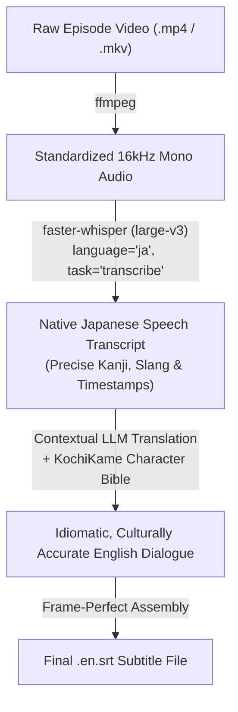

# KochiKame High-Accuracy English Subtitle Project 👮‍♂️📺

High-accuracy, frame-perfect English subtitles and automated translation pipeline for the legendary anime series ***Kochira Katsushika-ku Kameari Kōen-mae Hashutsujo*** (*KochiKame* / *Tokyo Beat Cops*).

---

## 📖 Background: The KochiKame Subtitle Problem

With over 370 episodes, *KochiKame* is one of the most beloved comedy anime in Japanese history, but it has historically suffered from a lack of complete, high-quality English localization:

1. **Official Human Subtitles (Episodes 1–50):**  
   The licensing consortium **REMOW** (via their YouTube channel `@ItsAnimeJP`) produced official, professional human translations with Closed Captions for the first 50 episodes.
2. **Community Machine Subtitles (The "Taku" Archive):**  
   Existing community archives for later episodes were generated by running OpenAI Whisper directly in translation mode:
   ```bash
   # The flaw in early automated subtitles:
   whisper "audio.mp3" --model medium --language Japanese --task translate
   ```
   **Why this fails:** Whisper is primarily an acoustic Automatic Speech Recognition (ASR) model, not a reasoning Large Language Model. Its built-in `--task translate` mode does not understand Japanese cultural context, fast-paced downtown slang, or police jargon. This resulted in notorious translation blunders:
   - *Shimatsusho* (始末書 - written disciplinary apology/reprimand reports) was mistranslated as **"island records"**.
   - *Kimodameshi* (肝試し - traditional test of courage) was mistranslated literally as **"test of the liver"**.
   - *Obake-yashiki* (お化け屋敷 - haunted house attraction) became **"ghost competition"**.
   - *Guinness Book* became **"kinesthetic book"**.
   - Furthermore, timestamps frequently suffered from cumulative timing drift relative to broadcast video files.

---

## 🚀 The Solution: Two-Stage Contextual Translation Pipeline

This project introduces a **two-stage hybrid localization pipeline** combining state-of-the-art speech recognition with domain-primed LLM translation:



### Stage 1: Native Japanese Speech Recognition (ASR)
Instead of forcing Whisper to translate, we run `faster-whisper-large-v3` in **native Japanese transcription mode** (`--task transcribe --language ja`). 
- **Prompt Priming:** We seed the model with character names (両津勘吉, 大原部長, 中川圭一, 秋本・カトリーヌ・麗子, 本田速人) and regional terms (葛飾署, 亀有公園前派出所, 下町, 始末書).
- **Result:** Whisper produces a timestamped Japanese transcript with near-100% phonetic and kanji accuracy.

### Stage 2: Contextual Localization with a Domain "Bible"
We pass the timed Japanese segments through an LLM using a curated **KochiKame Character Bible & Terminology Ruleset**:
- **Character Voices:** Preserves Ryotsu's loud, coarse *Shitamachi* downtown dialect and slang, Chief Ohara's stern paternal authority, Nakagawa's polite corporate etiquette, and Reiko's cosmopolitan wit.
- **Cultural Accuracy:** Idioms, cultural puns, and parody chants (such as *Sailor Moon* or *Akuma-kun* homages) are translated with proper humor rather than literal confusion.
- **Frame-Perfect Binding:** Every English line is bound directly 1-to-1 to the exact millisecond `start` and `end` times from the Japanese audio waveform.

---

## 🔍 Quality Comparison: Episode 51 (*"Profit from the Haunted House!"*)

| Scene | Raw Whisper `--task translate` (Original Archive) | This Pipeline (Whisper-Large-v3 + Domain LLM) |
| :--- | :--- | :--- |
| **Watermelon & Summer Heat** | *"Don't put seeds here, Ryo. But when we were children, we were looking forward to the ghost competition and the test of the liver."* | **"Hey, Ryo-san! Don't spit your watermelon seeds over here! Still, back when we were kids, we used to really look forward to tests of courage!"** |
| **Movie CGI & Monsters** | *"The children who are used to the recent movie SFX. They laugh at the first one. What is that SF something? There's something special about it."* | **"Kids today are used to insane Hollywood CGI and SFX. If you just show them a one-eyed boy or a faceless ghost, they'll just laugh. / What the heck is this 'SF-whatever'? / Special effects!"** |
| **Ryotsu's Scheme** | *"purikura where you can take two shots with ghosts and obaketchi that raise ghosts... off-man millionaire without a doubt!"* | **"Plus 'Ghost Purikura' photo booths where you snap pictures with real spirits! And 'Obaketchi' virtual pets where kids raise their own ghost! Hehehe! I'll become a multi-billionaire!"** |
| **The Ghosts' Grievance** | *"people who are doing cell phones or games don't even notice even if they stand behind them... Really, business is done like this."* | **"People are glued to their cell phones and video games. Even if we stand right behind them, they don't care! Modern folks have too many distractions! Our scaring business is totally ruined!"** |
| **The Exorcism Scene** | Fragmented machine nonsense. | Parody chants translated in full context (*"In the name of the Moon, I will punish you!"*, Iyami's *"Sheeeh!"*). |
| **The Twist Ending** | *"No, that person was possessing us. The real king of money is that person. What! How do you do with 1,225,000 yen I poured in!"* | **"No way! HE was haunting US! The real demonic monster of greed is that man! / WHAT?! What about the 1,225,000 yen I borrowed and sank into this?! I'm not letting you quit now!"** |

---

## 📁 Repository Structure

```
kochikame-subtitles/
├── README.md                  # Project documentation & methodology
├── LICENSE                    # MIT License
├── requirements.txt           # Python dependencies
├── scripts/
│   ├── extract_audio.py       # Audio demuxing utility (ffmpeg)
│   ├── transcribe.py          # Native Japanese Whisper transcription with priming
│   └── build_subtitles.py     # Frame-perfect SRT generator
├── data/
│   ├── glossary.json          # KochiKame Character Bible & terminology mapping
│   ├── ep51_ja_transcript.json# Raw Whisper Japanese transcript with millisecond timestamps
│   └── ep51_translations.json # Localized English dialogue mapped by segment ID
└── subtitles/
    └── Kochikame - S01E51 - Profit from the Haunted House!.en.srt
```

---

## 🛠️ How to Run the Pipeline

### 1. Prerequisites
Ensure you have `ffmpeg` and Python 3.10+ installed:
```bash
pip install -r requirements.txt
```

### 2. Extract Audio from Video
Extract the Japanese audio into a standardized 16kHz mono audio file:
```bash
python scripts/extract_audio.py -i "/path/to/episode_51.mp4" -o "./data/ep51.wav"
```

### 3. Generate Native Japanese Transcript
Run `faster-whisper-large-v3` on CPU or CUDA:
```bash
python scripts/transcribe.py -i "./data/ep51.wav" -o "./data/ep51_ja_transcript.json" --model large-v3 --device cpu
```

### 4. Build the Frame-Perfect `.srt`
Assemble the localized English lines directly into SubRip format:
```bash
python scripts/build_subtitles.py -t "./data/ep51_ja_transcript.json" -m "./data/ep51_translations.json" -o "./subtitles/Kochikame - S01E51 - Profit from the Haunted House!.en.srt"
```

---

## 🤝 Contributing

Contributions to translate additional un-subbed episodes or improve existing subtitle timings are very welcome! Please feel free to open a pull request or submit issue reports.

## 📄 License
This project is open-source under the [MIT License](LICENSE).
Anime media, characters, and trademarks belong to Osamu Akimoto, Shueisha, Fuji TV, and Studio Gallop.
